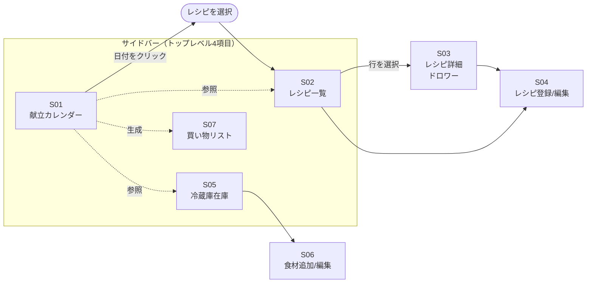

# meal-cycle プロダクト設計

このドキュメントは meal-cycle の「ユーザー体験」を固める設計ドキュメント。技術決定は [design.md](design.md) を参照。実装単位の仕様は [OpenSpec](design.md#8-openspec-の運用方針) の change proposal 側で扱う。

---

## 1. 想定利用シナリオ

### ナラティブ

利用者は好きなタイミング（主なケースとして日曜の夜など）に、来週 1 週間分の献立をこのアプリで組む。冷蔵庫の残り物（前週の残り、賞味期限が近いもの）を確認しながら、自分が作れるレシピの中から候補を選び、月〜金の夕食を割り当てる。組み終えたら、必要な食材のうち在庫に無いものが自動的に買い物リストとして集計される。

週の途中でも、その日作る予定のレシピを確認し、必要な食材があるか冷蔵庫を見る。買い物したら冷蔵庫画面で在庫を追加、料理したら（本人が覚えていれば）在庫を消費した数だけ減らす（在庫と献立の自動連動は MVP 後）。

新しく作れるようになった料理はレシピ画面から追加する。作ったことのない料理を試して定着させたい場合は、あとで「試したい」タグ等で候補管理する（タグ機能は将来検討）。

### 3 つの起点

アプリを開くトリガーは 3 パターンある：

- **献立を組みたい**: 献立カレンダーから開始 → レシピ一覧を参照 → 必要に応じて冷蔵庫を確認
- **これから料理する**: 献立カレンダー（当日）を開く → 割り当てられているレシピの詳細を見る
- **買い物や料理後の在庫更新**: 冷蔵庫画面から開始

### 献立の埋め方のデフォルト値（設定で変更可能）

ペルソナは基本的に**夕食のみ**、かつ**作り置きで 2〜3 日回す**。1 食は日によって**主菜 1 品〜主菜＋副菜＋汁物**と幅がある。この使い方が快適になるようデフォルト値を置く。ただし他の利用者（3 食毎日埋める、毎日別レシピを作る等）にも対応できるよう**可変性を残す**方針。

- 設定 UI 自体は S09（MVP 後）で生やす想定
- **MVP 期は定数としてハードコード**。ただし将来の設定移行を見越して、値の参照箇所を 1 箇所（`config` 定数モジュール等）にまとめる
- ユーザーがすぐに切り替えたい値（例: 時間帯表示）だけ、MVP でも画面上にトグルを置く

以下が可変にする値の一覧。実装時に MVP 期の定数モジュールを 1 箇所に集約し、S09 追加時にそこを設定ストアに差し替える。

| 項目                              | デフォルト                | 変更手段（想定）              | MVP でユーザーが変更可 |
| --------------------------------- | ------------------------- | ----------------------------- | :--------------------: |
| 時間帯表示                        | 夕食のみ                  | S01 右上トグル（既存）+ S09   | ✓                      |
| 献立を埋める曜日パターン           | 月〜金・夕 の 5 コマ       | S09 設定                      | —                      |
| **1 時間帯あたりの想定品数**      | 1〜3 品（緩い目安）       | S09 設定                      | —                      |
| 「久しぶりに」の消費期間閾値       | 10 日                     | S09 設定                      | —                      |
| 「作り置きコピー」の N プリセット | 2 / 3 / 4 日              | S09 設定                      | —                      |
| 週プリセット案の 1 週間内品数      | 2〜3 品                   | S09 設定                      | —                      |
| 「期限が近い」🔴 / 🟡 の日数閾値   | 3 日 / 7 日               | S09 設定                      | —                      |
| **S01 セルサイズプリセット**       | 期間 × 時間帯数 の 9 マス (1 週 × 夕食のみ = `min-h-48` / `text-base` / 4 品 など) | S09 設定 (`MealPlanCellSizePresets`) | — |

Recipe / StockItem のデータモデルは無変更。**MealPlan は 1 行 = 1 品に定義変更**（同一時間帯に 0..N 行が入る）→ 「1 食に主菜＋副菜＋汁物」を素直に表現できる。詳細は [design.md #4](design.md#4-データモデル初期案) の MealPlan。

### ペルソナ

現時点は自分ひとり。将来公開時の想定：

- 家族分の食事を作る立場の人（自炊派）
- 料理のレパートリーは 20〜50 品程度
- 一人暮らしで自炊するが、基本的には夕飯のみ
- 一品作ると消費は2,3日かかる。要するに作り置き。
- 毎日の献立を考えて当日に買い物して夕飯を作っているが、毎日献立を考えるのが面倒
- 購入した食材はその日のうちにすべて使いきれるわけではないので、残りの材料を考えて献立を考えるのが面倒
- カレンダーアプリで献立を管理するほどではないが、その週の予定を可視化したい
- 1週間の献立を勝手に考える、または、案を提示してほしい

---

## 2. 画面一覧

MVP スコープ内で必要な画面（「画面」は論理的なビュー単位。実装上はモーダル / ドロワーになるかもしれない）：

| ID  | 画面名             | 目的                                            | MVP |
| --- | ------------------ | ----------------------------------------------- | --- |
| S01 | 献立カレンダー     | 1〜4 週間分の献立を一覧・編集                   | ✓   |
| S02 | レシピ一覧         | 登録済みレシピを閲覧                            | ✓   |
| S03 | レシピ詳細         | 1 レシピの材料・手順・メモを見る                | ✓   |
| S04 | レシピ登録/編集    | レシピを新規登録・編集                          | ✓   |
| S05 | 冷蔵庫在庫         | 現在の在庫を一覧（並び替え含む）                | ✓   |
| S06 | 食材追加/編集      | 冷蔵庫に食材を追加・在庫量や期限を編集          | ✓   |
| S07 | 買い物リスト       | 献立に必要な食材のうち在庫に無いものを一覧      | ✓   |

MVP スコープ外だが将来必要になる想定：

| ID  | 画面名           | 追加予定タイミング                          |
| --- | ---------------- | ------------------------------------------- |
| S08 | 食材マスタ管理   | 食材の名寄せ辞書を明示管理したくなった時    |
| S09 | 設定             | 表示言語切替・データ import/export が必要な時 |
| S10 | レシピ検索       | レシピが数十件超えて絞り込みが欲しくなった時 |

---

## 3. 画面遷移図

### 遷移の考え方

- **サイドバー（垂直）でトップレベル切替**: S01 / S02 / S05 / S07 の 4 項目。将来 S08-S10 が増えても収まる
- **S01（献立カレンダー）はハブ**: 日付をクリック → その日の献立を編集 → レシピ選択画面（実質 S02）
- **S01 → S07 は生成関係**: 献立から必要食材を集計して買い物リストを更新
- **S03 レシピ詳細はドロワー**: 一覧の右側にドロワー展開（デスクトップアプリでの定番パターン）
- **S04 レシピ登録/編集**: 独立画面またはモーダル。行数が多くドロワーだと狭いため、ワイヤー時に判断
- **S06 食材追加/編集**: 冷蔵庫画面内のインライン UI かモーダルかはワイヤー時に判断

---

## 4. ワイヤーフレーム

各画面のワイヤーは [wireframes/](wireframes/) 配下に **drawio 形式**（`.drawio.svg`）で置く。ファイル命名や運用ルールは [wireframes/README.md](wireframes/README.md) 参照。

このセクションでは、ワイヤー本体からは読み取れない**相互作用・遷移ルール**と、**画面ごとの意図**だけを言葉で残す。見た目の細部は drawio 側を正とする。

### 共通シェル

全画面共通のレイアウト。ワイヤー: [wireframes/S00_shell.drawio.svg](wireframes/S00_shell.drawio.svg)

- サイドバー（左、固定幅）＋ メインエリアの 2 ペイン
- サイドバー項目は S01 / S02 / S05 / S07 の 4 つ、下部に将来の「設定」枠
- サイドバーは MVP では畳めない。選択中の項目をハイライト
- S03 レシピ詳細だけメイン右側にドロワーが重なる

---

### S01 献立カレンダー（ハブ画面）

ワイヤー: [wireframes/S01_meal_calendar.drawio.svg](wireframes/S01_meal_calendar.drawio.svg)

- **列 = 日付、行 = 時間帯（朝 / 昼 / 夕）** の CSS Grid。1 週なら 7 列、2 週なら 14 列（横スクロール想定）、4 週は行方向に折り返す
- **時間帯表示切替**（右上、期間切替の下）: 「夕食のみ」/「3 食表示」。**既定は「夕食のみ」**だが、他利用者は「3 食表示」に切り替えて使える（#1 の可変値一覧）。ワイヤー内では説明のため 3 食表示状態で描画している
- **1 セル = 1 時間帯 = 0..N 品**。1 品なら中央 1 行、2〜3 品なら縦積み表示、超過は「他 N 件」で省略
- **セル高さ / typography / 表示件数上限は「期間 × 表示時間帯数」で可変**。既定 (1 週 × 夕食のみ) は縦に大きめ (`min-h-48` / `text-base` / 最大 4 品)、密度が上がる (4 週など) と縮小する。9 プリセットの表は `internal/config/defaults.go` の `MealPlanCellSizePresets` を参照 (#1 の可変値一覧)。新レイアウトのワイヤーは [wireframes/S01_meal_calendar.v2.drawio.svg](wireframes/S01_meal_calendar.v2.drawio.svg)
- **セル内の操作**（1 品単位）
  - 空セル `＋` → レシピ選択ダイアログ（1 品追加）
  - 割当済セル右上 `＋` → もう 1 品追加
  - 各品行の `⋯` → 「この品を入れ替え / この品を削除 / この品のレシピ詳細を見る / **この品を連続 N 日** /
    作り置きから外す / 他の作り置きにまとめる」
- **作り置きの視覚識別**: 同じ作り置き (内部識別子は `batch_id`) に属する複数行の品には**共通の枠色** (3 色
  ローテーション) と `🔗` アイコンを描画する。1 行だけの作り置き (単独割当) には色を付けない。詳細は proposal
  `add-mealplan-batch-linking`
- **時間帯全体の操作**（セル右下 or 左端の `⋯` メニュー）
  - 「時間帯全体をクリア」 / 「**時間帯全体を連続 N 日コピー**」 / 「並び替え」
  - 「作り置きコピー」は時間帯内全品を同時にコピー。1 品だけコピーしたい場合は品単位の `⋯` から
  - 連続 N 日を選ぶと**コピー方法ダイアログ** (「作り置き = 1 回で作って N 日分」/「別調理 = N 回に分けて作る」)
    が挟まる。既定は「作り置き」(ペルソナと一致)
- 画面右上に**期間切替**（1 週 / 2 週 / 4 週）と前後ナビ
- 下部の「この期間の買い物リストを見る」CTA → S07 へ（表示中の期間を引き継ぐ）
- **MVP 後拡張**: レシピ選択ダイアログの上部に**候補セクション**（使い切り / 久しぶりに / 時短）を追加（ワイヤー: [wireframes/S01a_recipe_picker_dialog.drawio.svg](wireframes/S01a_recipe_picker_dialog.drawio.svg)）、および画面下部の「✨ 翌週の候補を出す（MVP 後）」CTA（既存 CTA 横）から**週プリセット案**を提示。方針は #5 参照
  - 週プリセット提示ダイアログのワイヤーは対応 proposal 着手時に作成

**遷移**: セル操作 → レシピ選択ダイアログ、`レシピ詳細を見る` → S03 ドロワー、下部 CTA → S07

---

### S02 レシピ一覧

ワイヤー: [wireframes/S02_recipe_list.drawio.svg](wireframes/S02_recipe_list.drawio.svg)

- テーブル形式（名前 / タグ / 材料数 / 更新日）
- 行クリック → **S03 レシピ詳細ドロワー**が右から展開（一覧は左に残る）
- `＋ 新しいレシピ` → **S04 レシピ登録画面**（フル遷移）
- 検索欄はレシピ名の部分一致のみ（タグ・材料での絞り込みは将来 S10）
- ソートは「更新日 desc（デフォルト）」「名前昇順」の 2 つのみ（MVP）

---

### S03 レシピ詳細（ドロワー）

ワイヤー: [wireframes/S03_recipe_detail.drawio.svg](wireframes/S03_recipe_detail.drawio.svg)

- S02 の右側に重ねて開く。ドロワー幅は画面の 40〜50%
- 閉じるボタン `×` または背景クリックで閉じる
- 表示項目: 基本情報（名前 / タグ / 人数 / 更新日）／ 材料 ／ 手順 ／ メモ ／ 操作ボタン（編集 / 削除）
- `編集` → **S04 レシピ編集画面**（フル遷移、既存値がロード済み）
- `削除` → 確認ダイアログ → 削除後は S02 に戻り、ドロワーは自動で閉じる
- S01 の割当ポップオーバー「詳細を見る」からも開かれる。この場合は S02 を経由せず、閉じると呼び出し元の S01 に戻る

---

### S04 レシピ登録 / 編集

ワイヤー: [wireframes/S04_recipe_edit.drawio.svg](wireframes/S04_recipe_edit.drawio.svg)

**方式**: 独立画面（フルビュー、左右 2 カラム）。決定理由は #7 参照。

- 上部固定バーに `保存` `キャンセル`。未保存で `キャンセル` を押した場合は確認ダイアログ
- 左カラム = 基本情報（名前 / タグ / 人数）+ 材料表 ／ 右カラム = 手順 + メモ
- 材料行 = 「食材（コンボボックス: 既存 Ingredient から候補 + 新規作成）」「量」「単位」「×」
- 手順は行追加型テキストエリア。並び替えは MVP では上下ボタン、ドラッグは後回し可
- 新規登録も同じ画面（タイトル `新しいレシピ`、初期値なし）

**遷移**: 保存 → 呼び出し元（S02 or S03）に戻り、対象レシピをハイライト。キャンセル → 呼び出し元に戻る

---

### S05 冷蔵庫在庫

ワイヤー: [wireframes/S05_fridge.drawio.svg](wireframes/S05_fridge.drawio.svg)

- 一番上に**インライン追加行**が常駐（詳細は S06）
- 期限の状態は色ドット: 🔴 3 日以内 / 🟡 7 日以内 / 🟢 それ以外
- 行の `編集` → その行がインライン編集モードに切り替わる（S06 参照）
- 行の `削除` → 確認ダイアログを挟まず即削除。トースト内 `元に戻す` で救済
- 並び順: 賞味期限近い順（デフォルト）／ 食材名 ／ 追加日新しい順

---

### S06 食材追加 / 編集

ワイヤー: [wireframes/S06_fridge_item_inline.drawio.svg](wireframes/S06_fridge_item_inline.drawio.svg)

**方式**: インライン（S05 一覧内で完結）。決定理由は #7 参照。

**追加行（S05 上部に常駐）**

- 食材コンボボックス（既存 Ingredient から候補 + 「新規作成: "◯◯"」）／ 量 ／ 単位 ／ 賞味期限（任意）／ `追加` ボタン
- 単位は選択中の Ingredient の `defaultUnit` が初期値
- `追加` 押下で登録 + 入力欄クリア → 連続追加が可能

**行内編集（既存行の `編集`）**

- その行のセルが全部入力可能に変わる。ドロワーやモーダルは開かない
- `保存` で確定、`キャンセル` で元に戻す

---

### S07 買い物リスト

ワイヤー: [wireframes/S07_shopping_list.drawio.svg](wireframes/S07_shopping_list.drawio.svg)

- 対象期間は S01 の表示期間と同期。S07 を単独で開いた場合は「今日 + 7 日」
- 各行 = 「食材名 / 必要量 / 用途（どのレシピで使うか）」＋ 買った・買ってないのチェックボックス
- 同じ食材が複数レシピで必要な場合は 1 行に合算、用途欄に複数レシピ名を列挙
- 冷蔵庫にある分は自動除外（必要量 vs 在庫量の比較）
- チェックを付けても在庫は増えない。下部の `☑ を冷蔵庫に登録して完了` で一括追加（賞味期限は空、後で S05 で編集）
  - 誤タップで在庫が汚れないように、一括登録の中間ステップを挟む方針

---

## 5. 献立候補の提示（MVP 後拡張）

ペルソナが感じている「毎日献立を考えるのが面倒」「残り材料を考えて献立を組むのが面倒」への打ち手。
全自動生成は AI を使わないと品質を担保しづらいため、**根拠つきの候補を数件提示してユーザーに選んでもらう**方式を採る。決定理由は #7 参照。

### 3 つの提示軸

いずれも既存データ（MealPlan 履歴 / StockItem / Recipe）のみで実装可能。追加のメタ情報は不要（あれば精度向上）。

| 軸           | ロジック                                                         | 根拠ラベル例         |
| ------------ | ---------------------------------------------------------------- | -------------------- |
| **使い切り** | 期限が近い在庫（🔴 / 🟡）を材料に含むレシピを、含む数の多い順       | 「🔴 牛乳 を使えます」 |
| **久しぶりに** | 「最終使用日 + **消費期間** N 日」を経過したレシピを、経過日数の大きい順 | 「2 週間ぶり」       |
| **時短**     | 所要時間 or 材料数が少ないレシピ（`estimatedMinutes` があれば併用） | 「20 分以内」        |

- 各候補には「なぜ選ばれたか」の 1 行根拠を UI に添える → ブラックボックス化を避ける
- 複数軸に該当するレシピは両方のセクションに表示する（バッジで示す想定）
- **各軸の閾値はすべて可変**（#1 の可変値一覧）。デフォルトは作り置きペルソナ向けに調整（消費期間 10 日、期限アラート 3 日 / 7 日、週プリセット品数 2〜3 品）。毎日別レシピ・毎食埋める運用のユーザーは S09（MVP 後）で下げられる

### 提示先（2 種類）

- **セル単位**: S01 の空セル `＋` → レシピ選択ダイアログ上部に「軸ごとのセクション」を追加。下部は既存の全レシピ一覧。ワイヤー: [wireframes/S01a_recipe_picker_dialog.drawio.svg](wireframes/S01a_recipe_picker_dialog.drawio.svg)
- **週単位**: S01 の「✨ 翌週の候補を出す」CTA → **1 週間 = 2〜3 品を連日に割り当てた**プリセット案を 2〜3 個提示（例: 「使い切り優先: 肉じゃが 3 日 → 麻婆豆腐 2 日」）。ペルソナが作り置きで回すため、5 日 = 5 レシピではなく**少数を連続配置**する形で生成する
  - 生成ロジック: 各軸のスコアで候補上位を選び、1 品あたり 2〜3 日連続に置く。1 プリセット内で同一レシピの重複は避ける
  - 1 時間帯あたりの品数プリセット（#1 の可変値）が 2 以上なら、主菜候補に副菜候補（時短軸のトップ）を添える形で生成
  - ユーザーはプリセットを選んでから個別セルの `⋯ → クリア / 入れ替え / 連続 N 日` で調整
  - ワイヤーは proposal 着手時に drawio で追加

### 前提となる proposal

`add-mealplan-assign-recipe`（MVP）が動いてから。「料理実施 → 在庫消費」の連動（[design.md #9](design.md#9-mvp-スコープ) の MVP 後候補）は**なくても提示は成立する**（ユーザーが手動で在庫を減らしていれば機能）。連動を後で入れると「使い切り」軸の精度が上がる。

対応 proposal は [design.md #8](design.md#8-openspec-の運用方針) に追加済み：`add-mealplan-suggest-by-stock` / `add-mealplan-suggest-by-recency` / `add-mealplan-suggest-week-preset`。

---

## 6. Gherkin シナリオ

capability 単位でファイルを分けて [scenarios/](scenarios/) 配下に置く。ファイル形式は `.feature`（Cucumber 系ツール標準）、日本語 Gherkin（`# language: ja`）で記述。

| ファイル                                                       | 対応 capability | 備考                     |
| -------------------------------------------------------------- | --------------- | ------------------------ |
| [scenarios/recipe.feature](scenarios/recipe.feature)           | recipe          | MVP                      |
| [scenarios/fridge.feature](scenarios/fridge.feature)           | fridge          | MVP                      |
| [scenarios/mealplan.feature](scenarios/mealplan.feature)       | mealplan        | 候補提示（#5）は `@planned` タグ付き |
| [scenarios/shopping.feature](scenarios/shopping.feature)       | shopping        | MVP                      |

- 運用ルール・記法は [scenarios/README.md](scenarios/README.md) 参照
- ここに書いてあるのは**受け入れ観点の骨子**。実装時は proposal 側 `openspec/changes/<name>/specs/<capability>/spec.md` に、事前条件・データ例つきで転記する
- ワイヤーで表現済みの見た目（列順、色ドット等）はシナリオでは再記述しない。[wireframes/](wireframes/) を正とする

---

## 7. 未決事項

- （現時点で未決の項目なし。次は proposal 単位で `openspec/changes/<name>/specs/<capability>/spec.md` に [scenarios/](scenarios/) のシナリオを転記していく）

### 決定事項

- **トップナビゲーション**: サイドバー（垂直）。将来項目が増えても収まるため
- **S03 レシピ詳細**: ドロワー展開（一覧の右側）
- **S04 レシピ登録/編集**: **独立画面（フルビュー）**。材料 + 手順が縦に長く、左右 2 カラムで組みたいためドロワー / モーダルは不採用
- **S06 食材追加/編集**: **インライン UI**。買い物直後の連続追加や、量 / 期限のさっとした修正を摩擦なくやりたいためモーダルは不採用
- **献立カレンダー初期表示**: 1 週間デフォルト、切替可能（2 週 / 4 週）
- **献立セルの空クリック → レシピ選択ダイアログ**（S02 のミニ版）。S02 本画面へは飛ばさない
- **買い物リストの購入済チェック**: チェック時は在庫に加えず、下部ボタンで一括登録（誤タップで在庫が汚れるのを避ける）
- **S05 の削除は確認ダイアログなし**、トーストの `元に戻す` で救済
- **献立提案の方針**: **全自動は採らず、根拠つきの候補提示に倒す**（#5）。理由は AI を使わない前提だと品質の主観判断（味／飽き／バランス）を機械化しにくく、入力メタデータへの依存も大きくなるため。ユーザーが最終選択することで、AI 抜きでも実用範囲に収まる
- **Gherkin シナリオはファイル分割**: capability 単位で [scenarios/](scenarios/) に `.feature` として置く。product.md 本文には概要と索引のみ残す
- **献立の埋め方は「作り置き前提のデフォルト + 可変」**: デフォルト値（夕食のみ / 週 2〜3 品 / 消費期間 10 日 等）は作り置きペルソナに合わせるが、**他利用者に切り替え可能な設計**にする。MVP 期は定数として 1 箇所に集約、S09 追加時にそこを設定ストアへ差し替える（可変項目一覧は #1）
- **設定 UI (S09) は MVP 後**: MVP 期に画面としては生やさない。ただし可変値の参照箇所は最初から 1 箇所に寄せておく（後付けで散在した参照を集約するのは高コスト）
- **1 時間帯 = 0..N 品を許容**: MealPlan を「1 行 = 1 品」に定義変更し、`(date, meal)` の一意制約を外す。主菜＋副菜＋汁物のような複数品構成を素直に表現するため。詳細は [design.md #4](design.md#4-データモデル初期案) の MealPlan
- **「作り置き」と「毎日別レシピ」の切替はデータモデルで持たない**: 同 `recipeId` を複数日に置くかどうかで両方表現できるため、追加フィールドや専用フラグは不要
