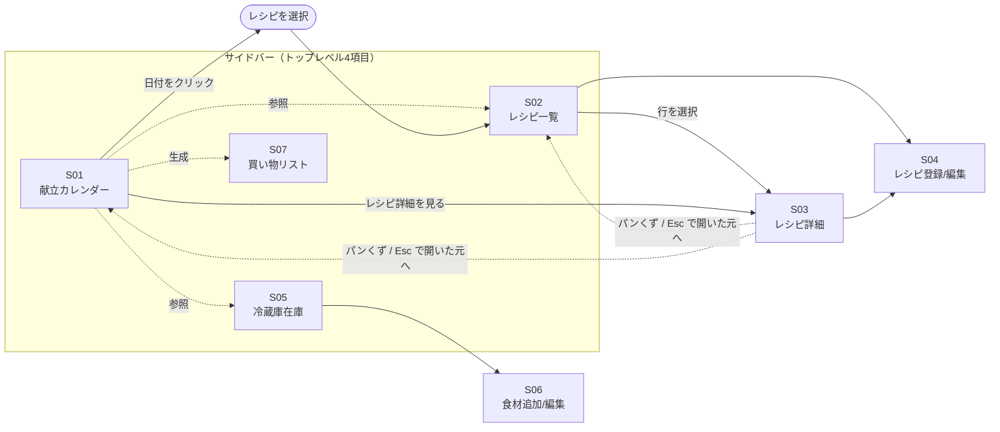

# meal-cycle プロダクト設計

このドキュメントは meal-cycle の「ユーザー体験」を固める設計ドキュメント。技術決定は [design.md](design.md) を参照。実装単位の仕様は [OpenSpec](design.md#8-openspec-の運用方針) の change proposal 側で扱う。

---

## 1. 想定利用シナリオ

### ナラティブ

利用者は好きなタイミング（主なケースとして日曜の夜など）に、来週 1 週間分の献立をこのアプリで組む。冷蔵庫の残り物（前週の残り、賞味期限が近いもの）を確認しながら、自分が作れるレシピの中から候補を選び、月〜金の夕食を割り当てる。組み終えたら、必要な食材のうち在庫に無いものが自動的に買い物リストとして集計される。

週の途中でも、その日作る予定のレシピを確認し、必要な食材があるか冷蔵庫を見る。買い物したら冷蔵庫画面で在庫を追加、料理したら（本人が覚えていれば）在庫を消費した数だけ減らす（在庫と献立の自動連動は MVP 後）。

新しく作れるようになった料理はレシピ画面から追加する。作ったことのない料理を試して定着させたい場合は、あとで「試したい」タグ等で候補管理する（タグ機能は将来検討）。

### 3 つの起点

アプリを開くトリガーは 3 パターンある：

- **献立を組みたい**: 献立カレンダーから開始 → レシピ一覧を参照 → 必要に応じて冷蔵庫を確認
- **これから料理する**: 献立カレンダー（当日）を開く → 割り当てられているレシピの詳細を見る
- **買い物や料理後の在庫更新**: 冷蔵庫画面から開始

### 献立の埋め方のデフォルト値（設定で変更可能）

ペルソナは基本的に**夕食のみ**、かつ**作り置きで 2〜3 日回す**。1 食は日によって**主菜 1 品〜主菜＋副菜＋汁物**と幅がある。この使い方が快適になるようデフォルト値を置く。ただし他の利用者（3 食毎日埋める、毎日別レシピを作る等）にも対応できるよう**可変性を残す**方針。

- 既定値は `internal/config/defaults.go` の 1 箇所に集約する。利用者が変えた値は S09 設定画面で保存し、既定値に重ねて使う（proposal: add-settings-screen）
- ユーザーがすぐに切り替えたい値（例: 時間帯表示）は、S09 ではなく画面上にトグルを置く
- 未実装の機能に属する値は、その機能を作る proposal で S09 に欄を足す。画面に出しても変える効果が無いため

以下が可変にする値の一覧。「画面から変更可」に ✓ の無い値は、今は既定値のまま動く。

| 項目                              | デフォルト                | 変更手段                      | 画面から変更可 |
| --------------------------------- | ------------------------- | ----------------------------- | :------------: |
| 表示言語                          | 日本語                    | S09 設定 (`Language`)         | ✓              |
| 時間帯表示                        | 夕食のみ                  | S01 右上トグル                | ✓              |
| 献立を埋める曜日パターン           | 月〜金・夕 の 5 コマ       | 週プリセットの proposal で S09 に足す | —      |
| **1 時間帯あたりの想定品数**      | 1〜3 品（緩い目安）       | 提案機能の proposal で S09 に足す | —          |
| 「久しぶりに」の消費期間閾値       | 10 日                     | 提案機能の proposal で S09 に足す | —          |
| 「作り置きコピー」の N プリセット | 2 / 3 / 4 日              | S09 設定 (`LeftoverCopyPresets`) | ✓           |
| 週プリセット案の 1 週間内品数      | 2〜3 品                   | 週プリセットの proposal で S09 に足す | —      |
| 「期限が近い」🔴 / 🟡 の日数閾値   | 3 日 / 7 日               | S09 設定 (`ExpiryAlertRedDays` / `ExpiryAlertYellowDays`) | ✓ |
| **S01 セルサイズプリセット**       | 期間 × 時間帯数 の 9 マス (1 週 × 夕食のみ = `min-h-48` / `text-base` / 4 品 など) | 変えない（見た目の調整値。`MealPlanCellSizePresets`） | — |
| 買い物リストの日数プリセット      | 3 / 4 / 7 / 14 / 28 日    | S09 設定 (`ShoppingPeriodDayPresets`) | ✓      |
| 買い物リストの既定日数            | 7 日                      | S09 設定 (`ShoppingDefaultPeriodDays`) | ✓     |
| 量る単位                          | 大さじ、小さじ、カップ    | S09 設定 (`MeasuringUnits`)   | ✓              |
| 量を持たない言葉（インポート時に量 0 として読む） | 少々、適量、適宜、少量、ひとつまみ、お好みで | S09 設定 (`UnquantifiedWords`) | ✓ |
| インポートで人数を省略したときの人数 | 2 人                    | S09 設定 (`RecipeImportDefaultServings`) | ✓   |
| 世帯人数（買い物リストの量の換算） | 換算しない                | 人数換算の proposal で S09 に足す | —          |

Recipe / StockItem のデータモデルは無変更。**MealPlan は 1 行 = 1 品に定義変更**（同一時間帯に 0..N 行が入る）→ 「1 食に主菜＋副菜＋汁物」を素直に表現できる。詳細は [design.md #4](design.md#4-データモデル初期案) の MealPlan。

### ペルソナ

開発者本人のひとり利用から始まった。将来公開時の想定：

- 家族分の食事を作る立場の人（自炊派）
- 料理のレパートリーは 20〜50 品程度
- 一人暮らしで自炊するが、基本的には夕飯のみ
- 一品作ると消費は2,3日かかる。要するに作り置き。
- 毎日の献立を考えて当日に買い物して夕飯を作っているが、毎日献立を考えるのが面倒
- 購入した食材はその日のうちにすべて使いきれるわけではないので、残りの材料を考えて献立を考えるのが面倒
- カレンダーアプリで献立を管理するほどではないが、その週の予定を可視化したい
- 1週間の献立を勝手に考える、または、案を提示してほしい

### 家族で使う場合

家族で暮らす利用者も、アプリを操作するのは献立を担当する 1 人とする。
アカウントや端末間の同期は持たず、ほかの家族には献立や買い物リストをテキストで渡す（S07 の「テキストでコピー」と同じ形）。

この前提では、操作しない家族の消費がアプリに届かない。
牛乳や食パンのように家族が日常的に食べる品は、量を記録してもすぐに実物とずれる。
そこで在庫を 2 種類に分ける。

- **献立の食材**：今の S05 のとおり、量と賞味期限で持つ。献立と買い物リストの計算に使う
- **常備品**：量を持たず、「ある / 少ない / ない」の状態だけを持つ。消費は記録せず、操作する人が気付いたときに状態を変える。
  「少ない」「ない」の品は、献立に関係なく買い物リストに載る

既定値はひとりの作り置き型のまま残し、家族向けには S09 で変える（#1 の表）。
常備品、在庫の見直しを速くする手段、世帯人数による換算は、それぞれ別の proposal で入れる（[design.md #9](design.md#9-mvp-スコープ)）。

---

## 2. 画面一覧

MVP スコープ内で必要な画面（「画面」は論理的なビュー単位。実装上はモーダル / ドロワーになるかもしれない）：

| ID  | 画面名             | 目的                                            | MVP |
| --- | ------------------ | ----------------------------------------------- | --- |
| S01 | 献立カレンダー     | 1〜4 週間分の献立を一覧・編集                   | ✓   |
| S02 | レシピ一覧         | 登録済みレシピを閲覧                            | ✓   |
| S02a | レシピのインポート | Markdown ファイルのレシピを確かめてまとめて登録 | ✓   |
| S03 | レシピ詳細         | 1 レシピの材料・手順・メモを見る                | ✓   |
| S04 | レシピ登録/編集    | レシピを新規登録・編集                          | ✓   |
| S05 | 冷蔵庫在庫         | 現在の在庫を一覧（並び替え含む）                | ✓   |
| S06 | 食材追加/編集      | 冷蔵庫に食材を追加・在庫量や期限を編集          | ✓   |
| S07 | 買い物リスト       | 期間の献立で使う材料の目安を在庫の有無つきで一覧 | ✓   |
| S09 | 設定               | 表示言語と、利用者ごとに変えたい値を変えて保存  | ✓   |

MVP スコープ外だが将来必要になる想定：

| ID  | 画面名           | 追加予定タイミング                          |
| --- | ---------------- | ------------------------------------------- |
| S08 | 食材マスタ管理   | 食材の名寄せ辞書を明示管理したくなった時    |
| S10 | レシピ検索       | レシピが数十件超えて絞り込みが欲しくなった時 |

---

## 3. 画面遷移図

### 遷移の考え方

- **サイドバー（垂直）でトップレベル切替**: S01 / S02 / S05 / S07 の 4 項目。将来 S08-S10 が増えても収まる
- **S01（献立カレンダー）はハブ**: 日付をクリック → その日の献立を編集 → レシピ選択画面（実質 S02）
- **S01 → S07 は生成関係**: 献立から必要食材を集計して買い物リストを更新
- **S03 レシピ詳細は独立画面**: サイドバーを除くメインエリア全体に表示する。S02 と S01 のどちらからも開け、上部のパンくずが開いた元を示す
- **S04 レシピ登録/編集**: 独立画面またはモーダル。行数が多くドロワーだと狭いため、ワイヤー時に判断
- **S06 食材追加/編集**: 冷蔵庫画面内のインライン UI かモーダルかはワイヤー時に判断

---

## 4. ワイヤーフレーム

各画面のワイヤーは [wireframes/](wireframes/) 配下に **drawio 形式**（`.drawio.svg`）で置く。ファイル命名や運用ルールは [wireframes/README.md](wireframes/README.md) 参照。

このセクションでは、ワイヤー本体からは読み取れない**相互作用・遷移ルール**と、**画面ごとの意図**だけを言葉で残す。見た目の細部は drawio 側を正とする。

### 共通シェル

全画面共通のレイアウト。ワイヤー: [wireframes/S00_shell.drawio.svg](wireframes/S00_shell.drawio.svg)

- サイドバー（左、固定幅）＋ メインエリアの 2 ペイン
- サイドバー項目は S01 / S02 / S05 / S07 の 4 つ、下部に区切って「設定」(S09)
- サイドバーは MVP では畳めない。選択中の項目をハイライト
- S03 と S04 は、メインエリアの上部にパンくずを置き、どの画面から開いたかを示す。サイドバー直下の画面 (S01 / S02 / S05 / S07 / S09) にはパンくずを置かない
- 配色は明るいテーマに固定する。OS がダークモードでも文字と背景は変わらない (ダークテーマは作らない)
- 起動時に DB を開けない、更新前の控えを作れない、スキーマの更新に失敗した、のいずれかが起きたら、
  サイドバーと各画面の代わりに起動時のエラー画面だけを出す。失敗した段階、詳細、DB の場所、控えの場所を示し、パスは選択してコピーできる
- 起動時は S09 で保存した表示言語を読んでから最初の画面を描く。起動時のエラー画面は表示言語を読めないので日本語で出す

---

### S01 献立カレンダー（ハブ画面）

ワイヤー: [wireframes/S01_meal_calendar.drawio.svg](wireframes/S01_meal_calendar.drawio.svg)

- **列 = 日付、行 = 時間帯（朝 / 昼 / 夕）** の CSS Grid。1 週 = 7 列 × 1 行、2 週 = 7 列 × 2 行折り返し、4 週 = 7 列 × 4 行折り返し。横スクロールは発生しない
- **時間帯表示切替**（右上、期間切替の下）: 「夕食のみ」/「3 食表示」。**既定は「夕食のみ」**だが、他利用者は「3 食表示」に切り替えて使える（#1 の可変値一覧）。ワイヤー内では説明のため 3 食表示状態で描画している
- **表示設定 (時間帯 / 期間長) は再起動後も保持される**。前回終了時の切替状態を復元する。ただし `期間の開始日` は毎回「今日を含む週の月曜」にリセットする (localStorage に保持し、S09 の設定とは別に持つ)
- **1 セル = 1 時間帯 = 0..N 品**。1 品なら中央 1 行、2〜3 品なら縦積み表示、超過は「他 N 件」で省略。「他 N 件」を押すとそのセルの全品の一覧が開き、畳まれた品にも作った印と品のメニューを使える
- **品行 = 「作った」チェックボックス + レシピ名** (proposal: revise-mealplan-item-row)。
  レシピ名は 2 行まで折り返し、2 行に収まらない分は省略記号で省略する。どの表示期間と時間帯数でも同じにする
- **セル高さ / typography / 表示件数上限は「期間 × 表示時間帯数」で可変**。既定 (1 週 × 夕食のみ) は縦に大きめ (`min-h-48` / `text-base` / 最大 4 品)、密度が上がる (4 週など) と縮小する。9 プリセットの表は `internal/config/defaults.go` の `MealPlanCellSizePresets` を参照 (#1 の可変値一覧)。新レイアウトのワイヤーは [wireframes/S01_meal_calendar.v2.drawio.svg](wireframes/S01_meal_calendar.v2.drawio.svg)
- **セル内の操作**（1 品単位）
  - 空セル `＋` → レシピ選択ダイアログ（1 品追加）
  - 割当済セル右上 `＋` → もう 1 品追加
  - 品行のレシピ名をクリック → 品のメニュー「この品を入れ替え / この品を削除 / この品のレシピ詳細を見る / 上へ移動 / 下へ移動 /
    **作り置きを広げる** / 作り置きをやめる / 他の作り置きにまとめる」。メニューは品行の右に開き、収まらないときは左に開く。
    キーボードでは、レシピ名にフォーカスを当てて Enter または Space で開く。品行に `⋯` は置かない
  - 「この品を削除」と「時間帯全体をクリア」は確認なしで即座に実行し、通知に `元に戻す` を出す
    (proposal: revise-mealplan-destructive-actions)。`元に戻す` を押すと、消した品が元のセルの元の並び順に戻り、
    作り置きへの属し方と「作った」印も削除の前の状態に戻る。通知が消えたあとは戻せない
  - 「作り置きをやめる」は、複数行の作り置きに属する品だけに出る。作り置きの最初の日の行だけを残し、ほかの行を削除する。
    最初の日に複数の時間帯の行があれば、朝食、昼食、夕食の順で早い行を残す (proposal: fix-mealplan-batch-boundaries)。
    どの行で選んでも残るのは最初の日の行なので、選ぶと確認のダイアログを開き、最初の日の行だけが残ることと削除される行の数を示す
  - S01 の操作が失敗したときは、理由を通知で知らせる。カレンダーの上部には残り続けるエラー表示を出さない
  - 「上へ移動」「下へ移動」は、セルに 2 品以上あるときだけ出る (proposal: revise-mealplan-reorder-menu)。
    その品を 1 つ上 / 1 つ下の品と入れ替える。先頭の品の「上へ移動」と末尾の品の「下へ移動」は押せない。
    作り置きに属する品はドラッグできないので、セルの中での並びはこの 2 つで変える
  - 品行の左端の「作った」チェックボックスは、その品を実際に調理したことを記録する (proposal: add-mealplan-cooked-mark)。
    すべての品行に常に表示し、1 クリックで印を付け外しする。チェックボックスを押しても品のメニューは開かない。
    印は材料を 1 回分として数える単位 (同じ作り置きの同じレシピ) に付き、作り置きの 1 行で選ぶと同じ作り置きの全行に付く。
    別調理の行には広がらない。前日に作り置きを作る使い方があるので、日付の制限は無い。
    印の付いた品は、チェックボックスがチェックされた状態になる (文字の濃さや作り置きの枠色は変えない)。
    入れ替えた品は印の無い状態になり、作り置きを広げた行と D&D で動かした行は印を引き継ぐ
  - 「他の作り置きにまとめる」の候補は「同じレシピ」「±4 日以内」の 2 条件のみで、**時間帯 (朝食 / 昼食 /
    夕食) は問わない**。別時間帯の作り置きにも合流でき、候補ダイアログは「月曜・夕食」のように時間帯名付きで
    表示する
  - 「作り置きを広げる」は 1 品を複数の (対象日, 対象時間帯) にまとめて広げる統合ダイアログを開く
    (proposal: revise-mealplan-leftover-ux)。対象日は起点日から未来 3 日ぶんの 4 行、時間帯 3 列の格子で
    チェックボックス複数選択。既定でチェックされるのは「起点日の翌日の同じ時間帯」の 1 セルだけ (旧「連続 2 日」相当)。
    起点セルと、起点と同じ作り置きの同じレシピがすでに入っているセルは選べない。
    起点と同じ日の、起点より前の時間帯 (夕食が起点なら同じ日の朝食と昼食) も選べない (proposal: revise-mealplan-spread-safety)。
    既存割当のあるセルの背景色は、格子のセルが S01 の表示期間の外にあっても付く。
    下部の「作り置き / 別調理」セグメント (既定: 作り置き) と「衝突: 追加 / 上書き」セグメント
    (既定: 追加) で反映方法を選ぶ。反映はチェックしたセルだけに入り、あいだの日は埋めない。
    「別調理」は同じ時間帯のセルにも別の時間帯のセルにも効く。全セルを 1 回の操作で反映し、
    1 セルでも反映できなければどのセルも変わらない (proposal: revise-mealplan-spread-api)。
    旧「この品を連続 N 日」と旧「別の時間帯にも作り置きを追加」はこのダイアログに統合されている
  - 反映後は、広げたセルの数 (上書きなら置き換えた品の数も) と `元に戻す` を通知に出す。
    `元に戻す` を押すと、広げて追加した行が消え、上書きで消えた品が元のセルの元の並び順に、作り置きへの属し方と「作った」印ごと戻る
- **D&D による 1 行 移動**（1 品単位、proposal: add-mealplan-drag-move）
  - 品行をドラッグ → 別セルにドロップで「元セルから 1 行削除 → ドロップ先セル末尾に挿入」する
  - **作り置きに属する行 (batch_member_count > 1) は D&D 対象外**。個別に動かすと作り置きのまとまりが
    崩れるため、`draggable=false` にする。作り置きの日をずらしたい場合は、品のメニューの「作り置きをやめる」で
    最初の日の行だけにし、残った行を D&D で動かしてから「作り置きを広げる」で広げ直す
  - 品行を押して動かさずに離すと品のメニューが開き、押したまま動かすとドラッグになる (ドラッグでは品のメニューは開かない)。
    チェックボックスを押した場合は、どちらも始めない
  - 品行は、作り置きに属するかどうかにかかわらず、ホバーでカーソルがポインタになり背景色が変わる。
    どの品行もクリックでメニューが開くことを示すためで、ドラッグできるかどうかはカーソルでは示さない
  - ドラッグ開始後、**カーソル追従の ghost** は薄い緑 (`bg-emerald-100 ring-emerald-400`) で描画され、
    **元の位置に残る source 行**は薄いグレーの placeholder (`bg-neutral-100 opacity-40`) に切り替わる。
    3 役 (ghost / source / drop target = 青枠) を色で塗り分けることで、視点が自然にカーソル (ghost)
    側に集まる
  - ドラッグ中はカレンダー上の全セルに枠強調が付き、drop 可能であることを示す
  - 同一セル内で他の品行にドロップした場合は既存 `ReorderMeal` に流し、position を差し替える
    (品のメニューの上へ / 下へ移動と同じ経路)。セル余白にドロップした場合は no-op
  - 修飾キー付き D&D (Ctrl キー等でコピー) はサポート外。コピーは品のメニューの「作り置きを広げる」経由で行う
  - モバイル / タッチ操作は MVP 対象外 (Windows デスクトップ想定)
- **作り置きの視覚識別**: 同じ作り置き (内部識別子は `batch_id`) に属する複数行の品には**共通の枠色** (3 色
  ローテーション) を描画する。1 行だけの作り置き (単独割当) には色を付けない。品行に `🔗` アイコンは出さず、枠の色だけで
  見分ける (レシピ名の幅を確保するため。S07 の献立欄の `🔗` は残る)。詳細は proposal `add-mealplan-batch-linking` と
  `revise-mealplan-item-row`
- **時間帯全体の操作**（セル右下 or 左端の `⋯` メニュー）
  - 「時間帯全体をクリア」 / 「**時間帯全体を連続 N 日コピー**」
  - 「作り置きコピー」は時間帯内全品を同時にコピー。1 品だけコピーしたい場合は品のメニューから
  - 連続 N 日を選ぶと**コピー方法ダイアログ** (「作り置き = 1 回で作って N 日分」/「別調理 = N 回に分けて作る」)
    が挟まる。既定は「作り置き」(ペルソナと一致)
- 画面右上に**期間切替**（1 週 / 2 週 / 4 週）と**前後ナビゲーション**（`＜` / `今週` / `＞`）を表示する
  （実装済み）。`＜` / `＞` は現在の期間長ぶんシフト（2 週表示なら 14 日戻る／進む）、「今週」は
  `periodStart` を「今日を含む週の月曜」にリセットする
- 下部の「この期間の買い物リストを見る」CTA → S07 へ（表示中の期間を引き継ぐ）
- **MVP 後拡張**: レシピ選択ダイアログの上部に**候補セクション**（使い切り / 久しぶりに / 時短）を追加（ワイヤー: [wireframes/S01a_recipe_picker_dialog.drawio.svg](wireframes/S01a_recipe_picker_dialog.drawio.svg)）、および画面下部の「✨ 翌週の候補を出す（MVP 後）」CTA（既存 CTA 横）から**週プリセット案**を提示。方針は #5 参照
  - 週プリセット提示ダイアログのワイヤーは対応 proposal 着手時に作成

**遷移**: セル操作 → レシピ選択ダイアログ、`レシピ詳細を見る` → S03 レシピ詳細画面（パンくずの「献立」か Esc で、開く前の表示期間のまま S01 に戻る）、下部 CTA → S07

---

### S02 レシピ一覧

ワイヤー: [wireframes/S02_recipe_list.drawio.svg](wireframes/S02_recipe_list.drawio.svg)、
[wireframes/S02a_recipe_import_dialog.drawio.svg](wireframes/S02a_recipe_import_dialog.drawio.svg)（インポートダイアログ）

- テーブル形式（名前 / タグ / 更新日）
- 行クリック → **S03 レシピ詳細画面**に移る。S03 から戻ると、検索語と並び順は開く前のまま残る。サイドバーから開き直したときは既定（検索語は空、更新日 desc）に戻る
- `＋ 新しいレシピ` → **S04 レシピ登録画面**（フル遷移）
- 検索欄はレシピ名の部分一致のみ（タグ・材料での絞り込みは将来 S10）
- ソートは「更新日 desc（デフォルト）」「名前昇順」の 2 つのみ（MVP）
- `インポート`（`＋ 新しいレシピ` の左）→ 「ファイルを選ぶ」「フォルダを選ぶ」のメニュー。選んだ Markdown ファイルを読み、**S02a インポートダイアログ**を開く（proposal: add-recipe-bulk-import）
  - ファイルの形式と、AI に変換させるプロンプトのひな形は [recipe-import.md](recipe-import.md) にまとめてある
  - `.md` が 1 つも無い、または 100 件を超えるときはダイアログを開かず、トーストで知らせる
  - S02a は読めたファイルが 1 件ならプレビュー（S03 と同じ表記）、2 件以上なら 1 ファイル 1 行の一覧にする。一覧では取り込む行をチェックで選び、エラーの行は選べない
  - 登録済みのレシピや同時に読んだファイルと名前が同じなら「同名あり」を出し、既定でチェックを外す。取り込めば別のレシピとして追加する
  - `取り込む` → 選んだレシピを 1 回でまとめて登録し、ダイアログを閉じて件数をトーストで知らせる。途中で失敗したら 1 件も登録しない
- `エクスポート`（`インポート` の左）→ OS のフォルダ選択ダイアログを開き、選んだフォルダの中に日時入りのフォルダを新しく作って、削除済みを除く全レシピを 1 レシピ 1 ファイルで書き出す（proposal: add-recipe-export）
  - 形式はインポートと同じで、書き出したファイルはそのままインポートで読み戻せる。ファイル名の規則と、手順の中の見出しを下げる扱いは [recipe-import.md](recipe-import.md) の「書き出し」にある
  - 書き出したら件数と書き出し先のフォルダをトーストで知らせる。ダイアログを閉じたときは何もしない
  - 書き込めなかったときは失敗をトーストで知らせ、作りかけのフォルダを残さない
  - レシピが 0 件のときは押せない

---

### S03 レシピ詳細

ワイヤー: [wireframes/S03_recipe_detail.v2.drawio.svg](wireframes/S03_recipe_detail.v2.drawio.svg)（初期案のドロワー版: [wireframes/S03_recipe_detail.drawio.svg](wireframes/S03_recipe_detail.drawio.svg)）

- サイドバーを除くメインエリア全体に表示する独立画面。S02 の行か、S01 の品行メニュー「この品のレシピ詳細を見る」から開く
- 上部にパンくず、レシピ名、基本情報（タグ / 人数 / 更新日）、操作ボタン（編集 / 削除）を置く。ボタンを上部に置くのは、手順が長くても下端までスクロールせずに編集へ進めるようにするため
- その下に、幅の広い画面では左に材料、右に手順とメモを並べる。幅の狭い画面では材料、手順、メモの順に縦に積む
- パンくずは `<開いた元> › <レシピ名>` で、開いた元は S02 なら「レシピ」、S01 なら「献立」。先頭を押すか Esc キーを押すと開いた元に戻る
  - 削除の確認ダイアログを開いているときの Esc は、ダイアログだけを閉じる
  - 戻った画面は開く前の状態を保つ。S02 は検索語と並び順、S01 は表示期間（開始日、期間長、時間帯表示）。スクロール位置は先頭に戻る
- 手順とメモは Markdown として描画する。完全ローカルを守るため、画像記法は代替テキストだけを出し（画像を読み込まない）、リンク記法は押しても遷移しない文字列として出す
- `編集` → **S04 レシピ編集画面**（フル遷移、既存値がロード済み）。S04 でキャンセルすると S03 に戻り、パンくずの開いた元も S04 に入る前のまま引き継ぐ
- `削除` → 確認ダイアログ → 削除すると開いた元の画面（S02 または S01）に戻り、削除した旨をトーストで知らせる
  - 削除は論理削除で、レシピ一覧と献立のレシピ選択から消える。すでに献立に入っている分は S01 に残り、買い物リストにも計上される
  - 削除済みレシピの品は、「作り置きを広げる」と「時間帯全体を連続 N 日コピー」で別のセルへ増やせない。
    試みると理由を通知で示し、献立は変えない (proposal: revise-mealplan-spread-safety)
  - S01 から削除済みレシピの詳細を開くと、中身と「削除済み」の表示を出し、`編集` と `削除` は出さない

---

### S04 レシピ登録 / 編集

ワイヤー: [wireframes/S04_recipe_edit.drawio.svg](wireframes/S04_recipe_edit.drawio.svg)

**方式**: 独立画面（フルビュー、左右 2 カラム）。決定理由は #7 参照。

- 上部固定バーに `保存` `キャンセル`。未保存で `キャンセル` を押した場合は確認ダイアログ
  - サイドバーで別の画面へ移るときも、未保存なら同じ確認ダイアログを出す。保存に成功したあとの移動では出さない（proposal: fix-recipe-form-and-list）
- 左カラム = 基本情報（名前 / タグ / 人数）+ 材料表 ／ 右カラム = 手順 + メモ
- 材料行 = 「食材（S06 と同じ候補補完つきの自由入力）」「量」「単位（既知の単位を候補に出す）」「×」
  - 食材の候補は在庫の食材名とレシピの材料名を合わせたもの。候補を選んだとき単位が空なら、直近に使われた単位を入れる（proposal: add-ingredient-name-matching）
  - 量は 0 以上 99999 以下。空と 0 は量を持たない材料（「塩 少々」など）として扱う（proposal: fix-recipe-amount-validation）
- 手順は 1 つのテキストエリアに Markdown で書く（番号付きリストや見出しが使える）。行の追加や並び替えの操作は持たない
- 新規登録も同じ画面（タイトル `新しいレシピ`、初期値なし）
- 上部にパンくずを置く。編集は `<S03 の開いた元> › <レシピ名> › 編集`、新規登録は `レシピ › 新しいレシピ`。パンくずで移るときも、未保存ならキャンセルと同じ確認ダイアログを出す

**遷移**: 保存 → S02 に戻り、対象レシピをハイライト（S03 をどこから開いていても S02）。キャンセル → 編集は S03、新規登録は S02 に戻る

---

### S05 冷蔵庫在庫

ワイヤー: [wireframes/S05_fridge.drawio.svg](wireframes/S05_fridge.drawio.svg)

- 一番上に**インライン追加行**が常駐（詳細は S06）
- 期限の状態は色ドット: 🔴 3 日以内（当日を含む）/ 🟡 7 日以内 / 🟢 それ以外。賞味期限が未入力の行はドットなし
- 期限切れ（残り日数がマイナス）は 🔴 と色だけで区別させず、ドットの代わりに「期限切れ」バッジを出し、行の背景を薄い赤にする。
  別枠にはまとめない（既定の賞味期限順で先頭に並ぶため）
- 残り日の列は「あと N 日」、当日は「今日まで」、期限切れは「N 日超過」、未入力は「—」
- 行の `編集` → その行がインライン編集モードに切り替わる（S06 参照）
- 行の `削除` → 確認ダイアログを挟まず即削除。トースト内 `元に戻す` で救済
- 並び順: 賞味期限近い順（デフォルト、期限なしは末尾）／ 食材名 ／ 追加日新しい順。画面を離れるとデフォルトに戻る
- 上部の検索欄で食材名の部分一致に絞り込む

---

### S06 食材追加 / 編集

ワイヤー: [wireframes/S06_fridge_item_inline.drawio.svg](wireframes/S06_fridge_item_inline.drawio.svg)

**方式**: インライン（S05 一覧内で完結）。決定理由は #7 参照。

**追加行（S05 上部に常駐）**

- 食材名（自由入力。既存の在庫名とレシピ材料名から部分一致の候補を出す）／ 量 ／ 単位 ／ 賞味期限（任意）／ `追加` ボタン
- 食材マスタは持たない。候補にない名前もそのまま登録でき、以後は候補に加わる
- 候補を選んだとき単位欄が空なら、その食材名で直近に使われた単位が入る
- 同じ食材名を追加しても既存行に合算せず、別の行になる（期限の違う実物を区別するため）
- `追加` 押下（または量 / 単位 / 賞味期限欄での Enter）で登録 + 入力欄クリア → 連続追加が可能

**行内編集（既存行の `編集`）**

- その行のセルが全部入力可能に変わる。ドロワーやモーダルは開かない
- `保存`（Enter）で確定、`キャンセル`（Esc）で元に戻す
- 同時に編集できるのは 1 行だけ。編集中は他の行の `編集` / `削除` を押せない

---

### S07 買い物リスト

ワイヤー: [wireframes/S07_shopping_list.drawio.svg](wireframes/S07_shopping_list.drawio.svg)（初期案）、
[wireframes/S07_shopping_list.v2.drawio.svg](wireframes/S07_shopping_list.v2.drawio.svg)（現在の構成）、
[wireframes/S07a_purchase_dialog.drawio.svg](wireframes/S07a_purchase_dialog.drawio.svg)（冷蔵庫への一括登録）

このリストは厳密な不足量ではなく、**期間の献立で使う材料の目安**として扱う（proposal: add-shopping-list）。
食材名は自由テキストで単位換算も無く、在庫との突き合わせは近似にしかならないため、在庫で足りる材料も含めて全部並べ、
在庫の有無は 3 段階の状態で添える。

- **対象期間**: S01 の「この期間の買い物リストを見る」から開くと S01 の表示期間（開始日と 7 / 14 / 28 日）が初期値。
  サイドバーから開くと「今日から 7 日間」（日数は S09 で変えられる）で、S01 の期間は引き継がない
  - S07 上部の開始日入力と日数プリセット（既定は 3 / 4 / 7 / 14 / 28 日。候補は S09 で変えられる）で切り替えられる。選んだ期間は保持せず、開き直すと既定に戻る
- **作り置きの数え方**: 同じ作り置きの同じレシピは、期間内に何日分あっても材料を 1 回分だけ計上する。
  期間より前から続く作り置きも、期間内に行があれば計上する（右側の献立欄に「期間前から」の印が付く）。
  S01 で「作った」印の付いた作り置きは調理を終えているので、材料テーブルにも「家にあるか確かめる材料」にも計上しない
  （proposal: add-mealplan-cooked-mark）
- **材料テーブル**: 列は「食材 / 必要量 / 在庫 / 用途」
  - 同じ「食材名 + 単位」は 1 行に合算し、必要量は期間の合計（在庫を引いた量ではない）
  - 食材名と単位は、ひらがなとカタカナ、全角と半角、英字の大文字と小文字をそろえてから比べる（在庫との突き合わせも同じ）。
    漢字とかな（「玉ねぎ」と「たまねぎ」）はそろえない。合算した行は期間内で最初に出てくる材料の表記で表示する（proposal: add-ingredient-name-matching）
  - 在庫は「在庫なし / 一部在庫あり / 在庫あり」。期限切れの在庫と、同名でも単位が違う在庫は数えない
  - 量を持たない材料（量 0 の「塩 少々」と、「醤油 大さじ 2」のように量る単位の材料）は、買う量として意味が無いので
    単位を問わず食材名だけで 1 項目にまとめ（proposal: add-measuring-units）、材料テーブルには出さない。
    テーブルと登録ボタンの下の別の欄「家にあるか確かめる材料」に、食材名と用途だけを並べる（proposal: add-shopping-pantry-section）
  - 別の欄は購入済チェックを持たず、一括登録と絞り込みの件数の対象にもしない。在庫は単位を問わず同名の在庫があれば「在庫あり」とし、
    その項目だけ薄い表示にして「在庫あり」を添える。調味料は S05 に登録しないことが多いので、「在庫なし」の印は出さない
  - 並び順は「在庫あり」以外を上、「在庫あり」を下（薄い表示）にまとめ、それぞれ最初に必要になる日、食材名、単位の順
  - 用途欄はレシピ名を、献立欄と同じ順（日付、時間帯、S01 のセル内の順）で列挙する
  - テーブルの直上で「すべて / 在庫なし・一部 / 在庫あり」に絞り込める（proposal: add-shopping-stock-filter）。
    各選択肢に件数を添え、並び順は絞り込む前と同じ。該当する行が無いときはテーブルの位置にその旨を出す
  - 絞り込みは保存せず、開き直すと「すべて」に戻る。期間を切り替えても絞り込みは保つ
  - 絞り込みで隠れた行のチェックは残り、登録の件数とダイアログにも含む。見出しの全選択は表示中の行だけに効く
- **この期間の献立（右側の欄）**: 材料を 1 回分として数える単位（作り置き × レシピ）ごとに 1 行。
  レシピ名、期間内の日付（連続なら「9/24〜26」、飛び飛びなら「9/24, 9/26」）、時間帯、作り置きの 🔗、「期間前から」の印を出す。
  S01 で「作った」印の付いた献立も一覧に残し、「作った」の印を添える。
  参照専用で、行から計上を外す操作は無い。狭い幅では材料テーブルの下に回る
- **空状態**: 献立が無い期間は「献立がない」旨だけを出す（献立欄も出さない）。献立はあるがレシピに材料が無い期間は、
  材料テーブルの位置にその旨を出し、献立欄は表示する。材料が量を持たない材料だけの期間は、材料テーブル、絞り込み、登録ボタンを出さず、
  テーブルの位置に「買う量の決まった材料はありません」と出して、その下に別の欄を表示する。
  期間の献立がすべて「作った」印付きのときは、材料の有無にかかわらず、材料テーブル、絞り込み、登録ボタン、別の欄を出さず、
  テーブルの位置に「この期間の献立はすべて作りました」の旨を出す（献立欄は表示する）
- **購入済チェックと一括登録**（proposal: add-shopping-purchase）: チェックは帰宅後、買ってきた食材を見ながら付ける想定。
  - 「在庫あり」の行も含めて全行にチェックを付けられる。見出しのチェックで表示中の全行を選択 / 解除する
  - チェックを付けただけでは在庫は増えない。チェックは保存せず、期間を切り替えたときと S07 を開き直したときに外れる
  - 材料テーブルの下の「チェックした食材を冷蔵庫に登録 (N 件)」で確認のダイアログ（S07a）を開く。
    チェックした食材が 1 行ずつ並び、食材名 / 量 / 単位 / 賞味期限を直してから一括で登録する
  - 初期値は、量が必要量、賞味期限が空。同じ食材の在庫があっても合算せず、新しい行として加える
  - 1 行でも不正な値があれば何も登録しない。キャンセルすると在庫は変わらず、チェックは残る
  - 登録するとチェックが外れ、件数をトーストで知らせる。材料テーブルはその場で算出し直され、在庫の状態が変わる
- **テキストでコピー**（proposal: add-shopping-copy-text）: 店内では S07 を開けないので、買う材料をテキストにしてスマホへ持ち出す。
  - 対象期間の表示の横（右端）に「テキストでコピー」ボタンを置く。押すとクリップボードにコピーし、件数をトーストで知らせる
  - コピーするのは、材料テーブルの「在庫なし」「一部在庫あり」の行と、「家にあるか確かめる材料」のうち在庫の無い項目だけ。
    1 行目に対象期間を添えた見出しを置き、行は「- 玉ねぎ 2 個」の形で材料テーブルと同じ順に並べる。用途と献立欄は含めない
  - 絞り込みと購入済チェックは、コピーの内容に影響しない
  - コピーする材料が無いとき（すべて在庫あり）はボタンを押せない。献立が無い期間と、材料が無い期間はボタンを出さない

### S09 設定

ワイヤー: [wireframes/S09_settings.drawio.svg](wireframes/S09_settings.drawio.svg)

利用者ごとに変えたい値を、表示 / 献立 / 冷蔵庫 / 買い物リスト / レシピの節に分けて並べる（proposal: add-settings-screen）。
変えられる値の一覧と既定値は #1 の可変値一覧を正とする。

- **保存の単位**: 画面下の「保存」が全項目をまとめて保存する。項目ごとの保存ボタンは置かない。
  開いてから値を変えていない間と、保存済みの値に戻した間は「保存」を押せない。並べ替えただけの変更も変更とみなさない
- **保存した値の反映**: 再起動せずに、S01 / S03 / S05 / S07 とレシピの取り込みへすぐ効く。
  保存の前に作った献立や登録したレシピは書き換えない。たとえば作り置きの日数の候補から 4 日を消しても、すでにある 4 日分の作り置きは残る
- **表示言語**: 選んだだけでは切り替わらず、「保存」を押した時点で切り替わる。
  選択肢は今の表示言語にかかわらず「日本語」「English」と各言語の名前で出す
- **候補と言葉の欄**: 値ごとのチップに × を付け、末尾の入力欄と「追加」で足す。Enter でも追加でき、IME の変換確定の Enter では追加しない。
  同じ値、空白だけの値、20 文字を超える単位と言葉は、追加の時点で欄の下にエラーを出す
- **買い物リストの 7 / 14 / 28 日は消せない**: S01 の 1 / 2 / 4 週の期間を S07 に引き継ぐときに、この日数を候補から選ぶため。
  これらのチップには × を出さない。サイドバーから開いたときの日数は候補から選び、選んでいた候補を消すと 7 日に戻る
- **保存できない値**: 🔴 の日数が 🟡 の日数以上、作り置きの候補が空、などは保存せず、該当する欄の下に理由を出す。何も保存しない
- **既定に戻す**: 確認ダイアログを出し、確認するとすべての値（表示言語を含む）を既定値に戻して保存する。取り消すと何も変えない。
  項目ごとに既定へ戻す操作は置かない
- **保存せずに離れたとき**: 別の画面へ移ると、変えた値は確認なしで捨てる。開き直すと保存済みの値が出る
- **保存した値を読めないとき**: 読めない項目だけ既定値で動き、S09 にもその既定値を出す。起動は止めない

---

## 5. 献立候補の提示（MVP 後拡張）

ペルソナが感じている「毎日献立を考えるのが面倒」「残り材料を考えて献立を組むのが面倒」への打ち手。
全自動生成は AI を使わないと品質を担保しづらいため、**根拠つきの候補を数件提示してユーザーに選んでもらう**方式を採る。決定理由は #7 参照。

### 3 つの提示軸

いずれも既存データ（MealPlan 履歴 / StockItem / Recipe）のみで実装可能。追加のメタ情報は不要（あれば精度向上）。

| 軸           | ロジック                                                         | 根拠ラベル例         |
| ------------ | ---------------------------------------------------------------- | -------------------- |
| **使い切り** | 期限が近い在庫（🔴 / 🟡）を材料に含むレシピを、含む数の多い順       | 「🔴 牛乳 を使えます」 |
| **久しぶりに** | 「最終使用日 + **消費期間** N 日」を経過したレシピを、経過日数の大きい順 | 「2 週間ぶり」       |
| **時短**     | 所要時間 or 材料数が少ないレシピ（`estimatedMinutes` があれば併用） | 「20 分以内」        |

- 「久しぶりに」の**最終使用日**は、S01 で「作った」印の付いた作り置きの行の日付のうち最も新しいものとする。
  印の無い行 (まだ作っていない予定) は数えない (proposal: add-mealplan-cooked-mark、計算は add-mealplan-suggest-by-recency で実装)
- 各候補には「なぜ選ばれたか」の 1 行根拠を UI に添える → ブラックボックス化を避ける
- 複数軸に該当するレシピは両方のセクションに表示する（バッジで示す想定）
- 条件を満たすレシピが無い軸は、セクションを消さずに「該当なし」と表示する。下部の全レシピ一覧は常に通常どおり出す
- **各軸の閾値はすべて可変**（#1 の可変値一覧）。デフォルトは作り置きペルソナ向けに調整（消費期間 10 日、期限アラート 3 日 / 7 日、週プリセット品数 2〜3 品）。毎日別レシピ・毎食埋める運用のユーザーが S09 で下げられるよう、各軸を作る proposal で S09 に欄を足す

### 提示先（2 種類）

- **セル単位**: S01 の空セル `＋` → レシピ選択ダイアログ上部に「軸ごとのセクション」を追加。下部は既存の全レシピ一覧。ワイヤー: [wireframes/S01a_recipe_picker_dialog.drawio.svg](wireframes/S01a_recipe_picker_dialog.drawio.svg)
- **週単位**: S01 の「✨ 翌週の候補を出す」CTA → **1 週間 = 2〜3 品を連日に割り当てた**プリセット案を 2〜3 個提示（例: 「使い切り優先: 肉じゃが 3 日 → 麻婆豆腐 2 日」）。ペルソナが作り置きで回すため、5 日 = 5 レシピではなく**少数を連続配置**する形で生成する
  - 生成ロジック: 各軸のスコアで候補上位を選び、1 品あたり 2〜3 日連続に置く。1 プリセット内で同一レシピの重複は避ける
  - 1 時間帯あたりの品数プリセット（#1 の可変値）が 2 以上なら、主菜候補に副菜候補（時短軸のトップ）を添える形で生成
  - ユーザーはプリセットを選んで「この案を適用」を押すと S01 の該当セルに割り当たる。以後は個別セルの `⋯ → クリア / 入れ替え / 連続 N 日` で調整
  - ワイヤーは proposal 着手時に drawio で追加

### 前提となる proposal

`add-mealplan-assign-recipe`（MVP）が動いてから。「料理実施 → 在庫消費」の連動（[design.md #9](design.md#9-mvp-スコープ) の MVP 後候補）は**なくても提示は成立する**（ユーザーが手動で在庫を減らしていれば機能）。連動を後で入れると「使い切り」軸の精度が上がる。

対応 proposal は [design.md #8](design.md#8-openspec-の運用方針) に追加済み：`add-mealplan-suggest-by-stock` / `add-mealplan-suggest-by-recency` / `add-mealplan-suggest-week-preset`。

---

## 6. 受け入れシナリオ

受け入れシナリオは capability ごとに `openspec/specs/<capability>/spec.md` の `#### Scenario:` として書き、そこだけを正とする。
proposal を切るときに delta spec として書き、archive で `openspec/specs/` に合成される。
Playwright E2E のテスト名はこのシナリオ名と一字一句対応させる（[../frontend/e2e/README.md](../frontend/e2e/README.md)）。

- proposal になる前の構想（#5 の献立候補、S07 の購入済チェック、S03 の削除など）は、この product.md に文章で置く。シナリオへの落とし込みは proposal 側で行う
- ワイヤーで表現済みの見た目（列順、色ドット等）はシナリオでは再記述しない。[wireframes/](wireframes/) を正とする

---

## 7. 未決事項

- （現時点で未決の項目なし）

### 決定事項

- **トップナビゲーション**: サイドバー（垂直）。将来項目が増えても収まるため
- **S03 レシピ詳細**: **独立画面（メインエリア全体）**。当初は一覧を左に残せるドロワーにしたが、手順とメモを Markdown で書けるようになり、S03 は手順を読みながら調理する画面になった。ドロワーの幅では手順が細かく折り返され、開いている間は背後の一覧も操作できなかった。S04 と同じ独立画面にそろえ、戻り先はパンくずで示す（revise-recipe-detail-page）
- **S04 レシピ登録/編集**: **独立画面（フルビュー）**。材料 + 手順が縦に長く、左右 2 カラムで組みたいためドロワー / モーダルは不採用
- **S06 食材追加/編集**: **インライン UI**。買い物直後の連続追加や、量 / 期限のさっとした修正を摩擦なくやりたいためモーダルは不採用
- **献立カレンダー初期表示**: 1 週間デフォルト、切替可能（2 週 / 4 週）
- **献立セルの空クリック → レシピ選択ダイアログ**（S02 のミニ版）。S02 本画面へは飛ばさない
- **買い物リストの購入済チェック**: チェック時は在庫に加えず、下部ボタンから確認のダイアログで量と賞味期限を直してから一括登録する（誤タップで在庫が汚れるのを避ける）。S07 は店内では開けず、チェックは帰宅後に付けることになるため、賞味期限もその場で入れられるようにして S05 での二度手間をなくした
- **S05 の削除は確認ダイアログなし**、トーストの `元に戻す` で救済
- **S01 の削除とクリアも確認なし + `元に戻す`、「作り置きをやめる」だけは事前に確認する**: 削除とクリアは見えている品が消える操作で、
  消えたことが画面でわかるので S05 と同じ作法にそろえた。「作り置きをやめる」は表示中の期間の外にある行まで消え、
  選んだ行が残るとは限らないので、事後の通知より事前の確認が合う（revise-mealplan-destructive-actions）
- **献立提案の方針**: **全自動は採らず、根拠つきの候補提示に倒す**（#5）。理由は AI を使わない前提だと品質の主観判断（味／飽き／バランス）を機械化しにくく、入力メタデータへの依存も大きくなるため。ユーザーが最終選択することで、AI 抜きでも実用範囲に収まる
- **受け入れシナリオは openspec の spec.md に一本化**: 当初は `docs/scenarios/*.feature` に Gherkin で置いていたが、spec.md と二重管理になり、OpenSpec の archive の流れに乗らない `.feature` 側だけが古くなったため廃止した（#6）
- **献立の埋め方は「作り置き前提のデフォルト + 可変」**: デフォルト値（夕食のみ / 週 2〜3 品 / 消費期間 10 日 等）は作り置きペルソナに合わせるが、**他利用者に切り替え可能な設計**にする。MVP 期は定数として 1 箇所に集約、S09 追加時にそこを設定ストアへ差し替える（可変項目一覧は #1）
- **設定 UI (S09) は実装済みの機能の値から入れる**: 当初は MVP 後としていたが、既定値が合わない利用者に配布バイナリのまま変える手段が無く、フロントに Go の既定値の写しが残っていたため、add-settings-screen で S09 を作った。未実装の機能に属する値は、その機能の proposal で S09 に欄を足す。可変値の参照箇所を最初から 1 箇所に寄せておいたので、差し替えは `config.Defaults()` の上に保存した値を重ねるだけで済んだ
- **1 時間帯 = 0..N 品を許容**: MealPlan を「1 行 = 1 品」に定義変更し、`(date, meal)` の一意制約を外す。主菜＋副菜＋汁物のような複数品構成を素直に表現するため。詳細は [design.md #4](design.md#4-データモデル初期案) の MealPlan
- **「作り置き」と「毎日別レシピ」の切替はデータモデルで持たない**: 同 `recipeId` を複数日に置くかどうかで両方表現できるため、追加フィールドや専用フラグは不要
- **家族で使う場合も操作するのは献立担当の 1 人**: 家族ごとのアカウントや端末間の同期は、完全ローカルの方針とぶつかり、得るものに比べて費用が大きい。
  ペルソナの「家族分の食事を作る立場の人」が献立と買い物を引き受けている前提に合わせ、家族には献立や買い物リストをテキストで渡す（#1「家族で使う場合」）
- **在庫は「献立の食材は量、常備品は状態」の 2 種類にする**: 操作しない家族の消費はアプリに届かず、日常的に食べる品の量は記録してもずれる。
  すべてを状態で持つと、買い物リストの在庫判定と賞味期限の表示を作り直すことになるため、量で持つ食材はそのまま残す
- **既定値はひとりの作り置き型のまま、家族向けは S09 で変える**: 既定値を家族向けに変えるとひとりで使う利用者が戻す手間を負い、
  初回起動で選ばせる形はプリセットの仕組みと画面が増える。可変値を 1 箇所に寄せてあるので、家族向けに必要な値（世帯人数など）は S09 に足せば足りる
