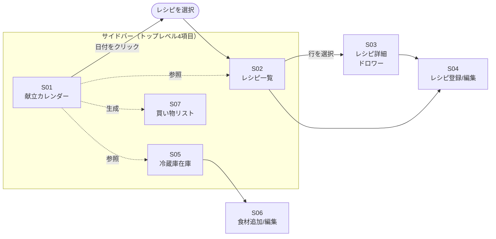

# meal-cycle プロダクト設計

このドキュメントは meal-cycle の「ユーザー体験」を固める設計ドキュメント。技術決定は [design.md](design.md) を参照。実装単位の仕様は [OpenSpec](design.md#8-openspec-の運用方針) の change proposal 側で扱う。

---

## 1. 想定利用シナリオ

### ナラティブ

利用者は好きなタイミング（主なケースとして日曜の夜など）に、来週 1 週間分の献立をこのアプリで組む。冷蔵庫の残り物（前週の残り、賞味期限が近いもの）を確認しながら、自分が作れるレシピの中から候補を選び、月〜金の夕食を割り当てる。組み終えたら、必要な食材のうち在庫に無いものが自動的に買い物リストとして集計される。

週の途中でも、その日作る予定のレシピを確認し、必要な食材があるか冷蔵庫を見る。買い物したら冷蔵庫画面で在庫を追加、料理したら（本人が覚えていれば）在庫を消費した数だけ減らす（在庫と献立の自動連動は MVP 後）。

新しく作れるようになった料理はレシピ画面から追加する。作ったことのない料理を試して定着させたい場合は、あとで「試したい」タグ等で候補管理する（タグ機能は将来検討）。

### 3 つの起点

アプリを開くトリガーは 3 パターンある：

- **献立を組みたい**: 献立カレンダーから開始 → レシピ一覧を参照 → 必要に応じて冷蔵庫を確認
- **これから料理する**: 献立カレンダー（当日）を開く → 割り当てられているレシピの詳細を見る
- **買い物や料理後の在庫更新**: 冷蔵庫画面から開始

### ペルソナ

現時点は自分ひとり。将来公開時の想定：

- 家族分の食事を作る立場の人（自炊派）
- 料理のレパートリーは 20〜50 品程度
- 冷蔵庫の在庫把握を頭でやっていて、限界を感じている
- カレンダーアプリで献立を管理するほどではないが、その週の予定を可視化したい

---

## 2. 画面一覧

MVP スコープ内で必要な画面（「画面」は論理的なビュー単位。実装上はモーダル / ドロワーになるかもしれない）：

| ID  | 画面名             | 目的                                            | MVP |
| --- | ------------------ | ----------------------------------------------- | --- |
| S01 | 献立カレンダー     | 1〜4 週間分の献立を一覧・編集                   | ✓   |
| S02 | レシピ一覧         | 登録済みレシピを閲覧                            | ✓   |
| S03 | レシピ詳細         | 1 レシピの材料・手順・メモを見る                | ✓   |
| S04 | レシピ登録/編集    | レシピを新規登録・編集                          | ✓   |
| S05 | 冷蔵庫在庫         | 現在の在庫を一覧（並び替え含む）                | ✓   |
| S06 | 食材追加/編集      | 冷蔵庫に食材を追加・在庫量や期限を編集          | ✓   |
| S07 | 買い物リスト       | 献立に必要な食材のうち在庫に無いものを一覧      | ✓   |

MVP スコープ外だが将来必要になる想定：

| ID  | 画面名           | 追加予定タイミング                          |
| --- | ---------------- | ------------------------------------------- |
| S08 | 食材マスタ管理   | 食材の名寄せ辞書を明示管理したくなった時    |
| S09 | 設定             | 表示言語切替・データ import/export が必要な時 |
| S10 | レシピ検索       | レシピが数十件超えて絞り込みが欲しくなった時 |

---

## 3. 画面遷移図

### 遷移の考え方

- **サイドバー（垂直）でトップレベル切替**: S01 / S02 / S05 / S07 の 4 項目。将来 S08-S10 が増えても収まる
- **S01（献立カレンダー）はハブ**: 日付をクリック → その日の献立を編集 → レシピ選択画面（実質 S02）
- **S01 → S07 は生成関係**: 献立から必要食材を集計して買い物リストを更新
- **S03 レシピ詳細はドロワー**: 一覧の右側にドロワー展開（デスクトップアプリでの定番パターン）
- **S04 レシピ登録/編集**: 独立画面またはモーダル。行数が多くドロワーだと狭いため、ワイヤー時に判断
- **S06 食材追加/編集**: 冷蔵庫画面内のインライン UI かモーダルかはワイヤー時に判断

---

## 4. ワイヤーフレーム

（次のイテレーションで書く）

---

## 5. Gherkin シナリオ

（次のイテレーションで書く）

---

## 6. 未決事項

- [ ] 各画面のワイヤー（#4）
- [ ] 各機能の Gherkin シナリオ（#5）
- [ ] S04 レシピ登録/編集を独立画面 / モーダル / ドロワーどれにするか（ワイヤー時に判断）
- [ ] S06 食材追加/編集をインライン / モーダルどちらにするか（ワイヤー時に判断）

### 決定事項

- **トップナビゲーション**: サイドバー（垂直）。将来項目が増えても収まるため
- **S03 レシピ詳細**: ドロワー展開（一覧の右側）
- **献立カレンダー初期表示**: 1 週間デフォルト、切替可能（2 週 / 4 週）
